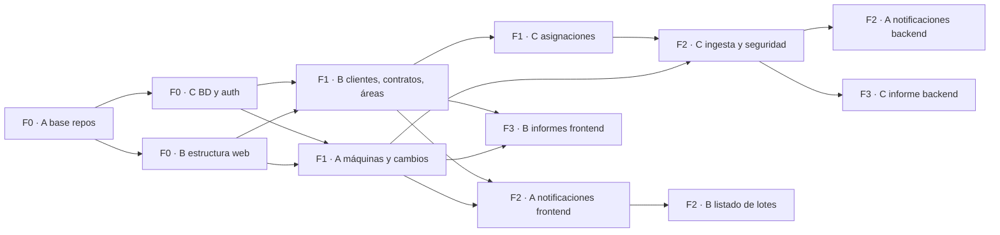

# PrintFlow · Plan real de trabajo (v2)

Ingeniería de Software II · Sección 4 · ESPOL · Cliente: DOX S.A.
Versión 2, 13 de noviembre de 2026. Reemplaza la asignación del *Sprint Planning* original; las historias, los puntos y los criterios de aceptación se mantienen salvo los cambios de la sección 7.

## 1. De dónde partimos

PrintFlow no se construye desde cero. Parte de **Contadores**, un sistema que ya funciona en DOX (~13 000 líneas de backend y ~17 000 de frontend). Ya hace clientes, contratos, áreas, máquinas, asignaciones, cambio de máquinas, ingesta desde n8n con aprobación por lotes, informe consolidado, PDF/Excel y notificaciones en tiempo real.

Al cierre del Sprint 2 este repo estaba vacío. El plan es:

1. **Fases 0, 1 y 2 (14 al 22 de noviembre):** migrar el código existente a los repos oficiales en **cajas** por equipo, corrigiendo lo que no cumple el plan original. Así nos ponemos al día con los Sprints 1 y 2.
2. **Fases 3 y 4 (Sprints 3 y 4):** construir lo que falta.

### 1.1 Alcance: de dónde vienen los reportes y por qué usamos datos simulados

- **Fuera de PrintFlow:** en DOX, las impresoras envían sus reportes de contadores por correo a un buzón. La configuración de las máquinas y el script que genera y envía esos correos los hizo y los mantiene el **técnico de DOX, nuestro Product Owner y entrenador técnico**. No es trabajo de este equipo.
- **Requisito del PO:** «Ustedes van a recibir estos reportes por montones y el sistema los debe registrar».
- **Nuestro alcance empieza en el buzón:** n8n lee los correos → extrae los contadores → API de ingesta → staging y lotes → aprobación → informe.
- **Datos simulados:** el buzón y el flujo reales ya están en **producción en el servidor de DOX**, y el PO no autoriza usarlos para el desarrollo. Por eso trabajamos con la **información de prueba que nos entregó el PO**: un buzón de prueba propio, correos de prueba con el mismo formato y máquinas, series e IP ficticias. **Nunca** se usan el buzón, el n8n ni los datos reales de clientes de DOX.

Cada caja está en la carpeta `CAJAS/` (fuera de los repos) y trae el código, su `TAREA.md` con los pasos exactos y las mejoras obligatorias. Cada equipo sube **su** caja con **sus** commits.

## 2. Repos y reglas

| Repo | Contenido |
|---|---|
| `SE2-4-Printflow` | Backend (Node 22 + Express 5 + PostgreSQL), migraciones `db/`, flujo `n8n/`, `docker-compose.yml`, este plan |
| `SE2-4-Printflow-Frontend` | SPA (React 19 + Vite + TypeScript + MUI + Tailwind) |

- Ramas: `main` (lo que se entrega o despliega), `develop` (integración) y `feature/<fase>-<tema>` (una por caja).
- Todo entra por **PR a `develop`**, con 1 aprobación de alguien **de otro equipo** y el CI en verde.
- Commits en español y en presente: `feat(clientes): valida RUC de 13 dígitos`. Cada integrante hace commits con su propia cuenta.
- Al cerrar cada fase: PR de `develop` a `main` y una demo corta.
- **Prohibido subir** `.env`, credenciales, dumps con datos reales o `chat-widget.js` (es del bot de Doxi, no de PrintFlow).

## 3. Equipos

| Equipo | Integrantes | Dueño de |
|---|---|---|
| **A** | Kiara Morán (QA) · Marlo Valle (Scrum Master, DevOps) | **Las bases:** repos, Docker, CI. Además, máquinas y cambios, notificaciones y detalle, n8n, SMTP, Excel y despliegue de demostración |
| **B** | María Gabriela Villón (documentación) · Roberto Barrios | Estructura de la web, clientes, contratos, áreas, listado de lotes, pantalla de informes, lectura manual, reprocesamiento, PDF, usuarios y roles |
| **C** | Samuel Chichande (líder técnico backend) · Christian Villacrés | Base de datos, autenticación y seguridad de la API, asignaciones, ingesta, validaciones, auditoría, cálculo del informe, rendimiento, prueba E2E |

Las cajas de cada equipo están en `CAJAS/EQUIPO-A_Kiara-Marlo`, `CAJAS/EQUIPO-B_Gabriela-Roberto` y `CAJAS/EQUIPO-C_Samuel-Christian`.

`CODEOWNERS` (completar con los usuarios de GitHub):

```text
# Equipo A
/docker-compose.yml  /docker/  /.github/  /n8n/   @kiara @marlo
/src/**/maquina/                 @kiara @marlo
/src/**/cambio/                  @kiara @marlo
/src/**/notificaciones/          @kiara @marlo
# Equipo B
/src/**/cliente/                 @gabriela @roberto
/src/**/contrato/                @gabriela @roberto
/src/**/area/                    @gabriela @roberto
# Equipo C
/db/                             @samuel @christian
/src/**/usuario/                 @samuel @christian
/src/**/instalacion/             @samuel @christian
/src/**/ingesta/                 @samuel @christian
/src/**/lotes_carga/             @samuel @christian
/src/**/reportemes*/             @samuel @christian
```

## 4. Calendario

| Fase | Fechas | Sprint del plan | Objetivo |
|---|---|---|---|
| **0 · Cimientos** | 14 al 17 nov | Sprint 1 (pendiente) | Repos, Docker, CI, BD, login y estructura web |
| **1 · Catálogos** | 17 al 20 nov | Sprints 1 y 2 (pendientes) | Clientes, contratos, áreas, máquinas y asignaciones |
| **2 · Ingesta** | 20 al 22 nov | Sprint 2 (pendiente) | Ingesta segura, lotes, notificaciones y API cerrada con token |
| **3 · Informe** | 23 nov al 13 dic | Sprint 3 | Validaciones, auditoría, informe, lectura manual, reprocesar, SMTP |
| **4 · Entrega** | 14 dic al 8 ene | Sprint 4 | PDF/Excel, usuarios, despliegue HTTPS, rendimiento, E2E con el PO |

### Orden de subida (dependencias comprobadas compilando cada caja)



Regla: **en cada fase va primero A, luego B y al final C** (C cierra cada fase y el proyecto). Son 15 cajas en total; el orden numerado está en `CAJAS/README.md`. Se comprobó compilando y arrancando cada caja en ese orden.

## 5. Las cajas (Fases 0 a 3)

| Caja | Equipo | Historias | Contenido principal | Fecha |
|---|---|---|---|---|
| `EQUIPO-A_Kiara-Marlo/fase-0_base-repos` | A | S1-01 | Esqueleto de los dos repos, Docker Compose, CI, plantillas | 15 nov |
| `EQUIPO-B_Gabriela-Roberto/fase-0_estructura-web` | B | S1-06 | Layout, login, rutas protegidas, componentes compartidos | 17 nov |
| `EQUIPO-C_Samuel-Christian/fase-0_bd-y-auth` | C | S1-02, S1-03 | Esquema `public` limpio, catálogos, login, `protect` | 17 nov |
| `EQUIPO-A_Kiara-Marlo/fase-1_maquinas-y-cambios` | A | S1-05 + cambio de máquinas | CRUD de máquinas, modelos y reemplazos | 19 nov |
| `EQUIPO-B_Gabriela-Roberto/fase-1_clientes-contratos-areas` | B | S1-04, S2-01, (áreas de S2-02) | CRUD de clientes, contratos y áreas | 19 nov |
| `EQUIPO-C_Samuel-Christian/fase-1_asignaciones` | C | S2-02 | Asignar una máquina a un área bajo un contrato | 20 nov |
| `EQUIPO-A_Kiara-Marlo/fase-2_notificaciones-y-n8n` | A | S2-04, S2-06 | Notificaciones en tiempo real, detalle de lote, flujo n8n | 22 nov |
| `EQUIPO-B_Gabriela-Roberto/fase-2_listado-de-lotes` | B | S2-05 | Listado de lotes con estado y filtros | 22 nov |
| `EQUIPO-C_Samuel-Christian/fase-2_ingesta-y-seguridad` | C | S2-03 + cierre de la API | Ingesta, lotes, staging, `protect` en todo `/api` | 22 nov |
| `EQUIPO-B_Gabriela-Roberto/fase-3_informe-frontend` | B | S3-07, S3-04, S3-05 | Pantalla de informes + lectura manual + reprocesar | 13 dic |
| `EQUIPO-C_Samuel-Christian/fase-3_informe-backend` | C | S3-06, S3-01, S3-02 | Consolidado + validaciones + auditoría | 13 dic |

## 6. Trabajo nuevo de las Fases 3 y 4 (sin código previo)

| Fase | Equipo | Historia | Responsable | Pts |
|---|---|---|---|---|
| 3 | C | S3-01 Validaciones de lecturas (retroceso, salto anómalo, duplicado) | Samuel | 5 |
| 3 | C | S3-02 Auditoría (`registro_auditoria`) | Samuel | 3 |
| 3 | C | S3-06 Verificar y completar el cálculo del consolidado | Christian | 8 |
| 3 | B | S3-07 Verificar la pantalla de informes contra los criterios | Gabriela | 5 |
| 3 | B | S3-04 Lectura manual | Roberto | 3 |
| 3 | B | S3-05 Reprocesar reportes con error (máx. 3 intentos) | Roberto | 3 |
| 3 | A | S3-03 Notificación por SMTP al operador | Kiara | 3 |
| 3 | A | S3-08 Reintentos IMAP en n8n y alerta al administrador | Marlo | 2 |
| 4 | B | S4-01 PDF del consolidado: verificar contra los criterios (ya existe) | Gabriela | 3 |
| 4 | A | S4-02 Excel con columnas numéricas: verificar (ya existe) | Kiara | 2 |
| 4 | B | S4-03 Gestión de usuarios y roles + menú filtrado por rol | Roberto | 3 |
| 4 | A | S4-04 Despliegue de demostración (Azure for Students o servicios gratuitos; no en el servidor de DOX): HTTPS, redirección HTTP, respaldo diario de 30 días | Marlo | 5 |
| 4 | C | S4-05 Índices y medición < 5 s con 500 máquinas | Christian | 2 |
| 4 | C | S4-06 Prueba E2E correo → lectura → informe, y defectos de UAT | Samuel | 3 |

## 7. Cambios respecto al Sprint Planning original

| Tema | El plan decía | En la realidad | Decisión |
|---|---|---|---|
| Punto de partida | Construir desde cero | Existe un sistema en producción | Migrar por cajas y mejorar (sección 1) |
| Asignación | Tabla `asignacion` | Tabla `instalaciones` | Se mantiene el nombre en la BD; en la UI se dice «Asignaciones» |
| Tarifas | Tabla `tarifa` aparte | Columnas dentro de `contratos` (B/N, color, incluidas, excedente) | Se mantiene: cubre los criterios de HU-05 sin otra tabla |
| Lecturas | B/N y color | Separa impresiones y copias, B/N y color (4 contadores) | Se mantiene: es más fiel a la facturación real |
| Estados del reporte | PENDIENTE, PROCESADO, DESCARTADO, ERROR | Staging → lote → **aprobación manual** | Se mantiene la aprobación. Equivalencias: en staging = PENDIENTE, aprobado = PROCESADO, rechazado o duplicado = DESCARTADO, y se agrega ERROR con motivo |
| Identificar la máquina | Por correo emisor | Por número de serie | Serie como clave; correo emisor como dato nuevo (decisión del PO) |
| Roles | Administrador, Operador, Facturación | `admin`, `operador`, `auditor` | Facturación = `auditor` (lectura e informes). Renombrar en el seed |
| Cambio de máquinas | No estaba | Existe (reemplazo con contadores) | Se incorpora a la Fase 1 · A |
| Áreas | Samuel (S2-02) | La pantalla depende de Clientes | Pasan al Equipo B |
| Notificaciones | In-app + SMTP en Sprint 3 | In-app en tiempo real ya existe | Fase 2 migra lo existente; S3-03 agrega SMTP |
| PDF y Excel | Se construyen en Sprint 4 | Ya existen | S4-01 y S4-02 pasan a verificar y corregir |
| Sesión | 30 min de inactividad | JWT fijo de 2 h | C lo corrige en la Fase 0 |
| Seguridad de la API | 401/403 en rutas protegidas | **Toda la API abierta sin token** | C lo corrige en la Fase 2 (prioridad máxima) |
| Migraciones | Versionadas | No había (el `knexfile` apuntaba a MySQL) | Esquema `public` extraído y limpio en `db/` |

## 8. Antes de subir cualquier cosa

- [ ] Rotar la contraseña de la BD de Supabase y el `SECRET_KEY` de producción (quedaron expuestos en archivos locales)
- [ ] Cambiar la contraseña del admin de producción (sigue en la de prueba)
- [ ] Revisar que ningún PR traiga `.env`, dumps con datos o el `chat-widget.js`

## 9. Decisiones pendientes del Product Owner

1. ¿Se mantiene la aprobación manual de lotes o se pasa a ingesta automática con estados?
2. ¿La máquina se identifica por serie, por correo emisor o por ambos?
3. ¿Contrato con código, tipo de servicio y día de corte (campos nuevos)?
4. ¿El rol `auditor` se renombra a «Facturación»?
5. ¿El cambio de máquinas entra en la demo final?
